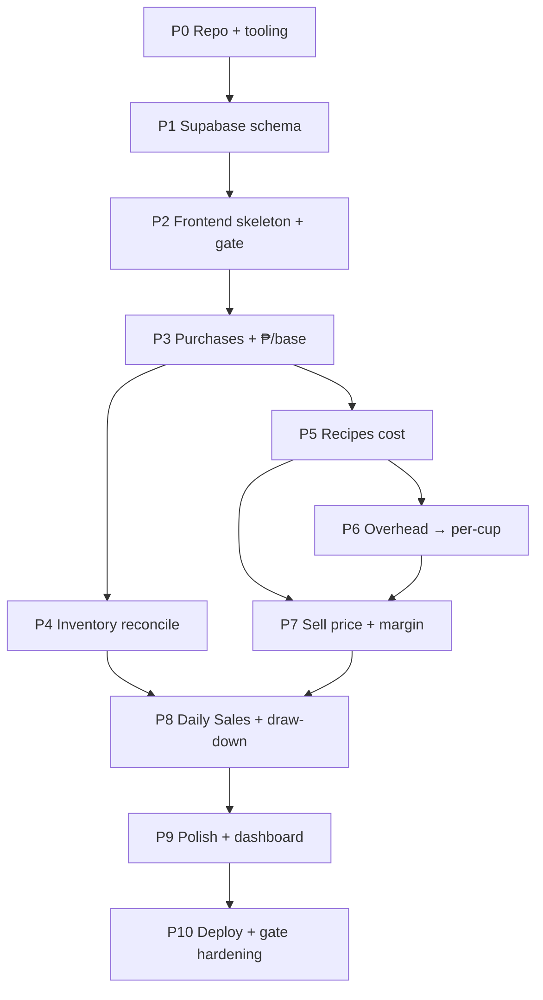

# Sleepless Café — Development Plan (Phase by Phase)

Companion to `PLAN.md`. This is the **build roadmap**: ordered phases, each with a goal, deliverables, a **done-when checkpoint**, and what it unlocks.

**Discipline:** every phase ends with a checkpoint that must pass before the next phase starts. We never build on a broken foundation. Each phase is one focused session.

> **Re-architecture note:** the site was later re-architected from the original 6-page map to a 6-module map (see `MODULE1-webpage1.md` + `REV_PLAN.md`). The **Ordering** page (P8 here) was retired and replaced by **Module 5 Daily Sales** + **Module 6 Inventory**. The actual build followed `REV_PLAN.md` phases R0–R12; this roadmap below is the original design intent, kept for reference.

---

## Phase dependency map

The math chain drives the order: **purchases → ₱/base → (inventory, recipe cost) → margin → daily-sales**.

---

## Phase 0 — Repo & tooling scaffold

**Goal:** a runnable static site skeleton under version control, previewable locally.

**Deliverables**
- Git repo at `c:\Users\USER\Desktop\Sleepless Cafe` (init, `.gitignore`, `README.md`).
- `index.html` + `assets/` (css/js) folder structure.
- A local preview command (e.g. `python -m http.server` or `npx serve`) documented in README.
- Dark espresso theme tokens defined in one CSS file (`--bg`, `--ink`, `--amber`, peso font).

**Done-when:** local server serves `index.html` and the theme colors render.

**Unlocks:** everything after.

---

## Phase 1 — Supabase schema + seed data

**Goal:** the 5 tables exist and return data over the API.

**Deliverables**
- Create Supabase project (free tier).
- Tables with exact columns from `PLAN.md §2`: `purchases`, `recipes`, `overhead`, `orders`, `stocktakes`.
- Column types set (numbers as `numeric`, JSON arrays as `jsonb`).
- 3–5 seed rows in `purchases` (the milk example: 4×250 ml ₱45, 3×350 ml ₱40) so later math is testable.
- Read rules configured for the publishable key (staff-only read; write via gate — see Phase 10 note).

**Done-when:** a `curl`/fetch to the Supabase REST endpoint returns the seed purchases.

**Unlocks:** P3–P8 data access.

---

## Phase 2 — Frontend skeleton + passphrase gate

**Goal:** gate unlocks and 6 empty pages render with nav.

**Deliverables**
- Passphrase gate: enter passphrase → store a session token in `localStorage` for the visit.
- 6 page shells (Purchases, Recipes, Overhead, Selling price, Ordering, Stock-take) + a Dashboard shell.
- Shared nav (top bar, collapses to hamburger on mobile).
- A thin `supabase.js` helper: `getData(table)` via the publishable key.

**Done-when:** entering the passphrase reveals the nav and all 6 empty pages.

**Unlocks:** all page phases.

---

## Phase 3 — Purchases + ₱/base (foundation math)

**Goal:** page 1 lists purchases and shows correct derived numbers.

**Deliverables**
- Render purchases table from Supabase.
- Compute and display `price_per_base = cost_price / (qty_packs × pack_size)`.
- Compute `on_hand_base = Σ(qty_packs × pack_size)` (sold term = 0 until P8).
- **Low** badge when `on_hand < low_at`.
- Add-row form (name, brand, pack size, base unit, qty packs, price, supplier, date).
- **Restock** action: adds qty, keeps recorded price.

**Done-when:** adding the milk example shows ₱0.045/ml and ₱0.038/ml, and on_hand totals correctly.

**Unlocks:** P4 (needs on_hand) and P5 (needs ₱/base).

---

## Phase 4 — Stock-take reconcile

**Goal:** page 6 turns the record into lost-cost / savings / net.

**Deliverables**
- For each item: `on_hand_base` (from P3) vs entered `actual_base`.
- `variance = actual − on_hand`; `impact = |variance| × price_per_base`, signed (− lost, + savings).
- Color-code amber (lost) / green (savings).
- Footer: **Total lost ₱ · Total savings ₱ · Net ₱**.
- Setting a count **sets `on_hand = actual`** (record self-corrects).
- History list of past stock-takes (date + counter).

**Done-when:** a count where actual < record produces the right lost-cost number and updates on_hand.

**Unlocks:** P8 (draw-down must coexist with reconciled on_hand).

---

## Phase 5 — Recipes cost (free, no draw-down)

**Goal:** page 2 computes one-cup cost from current ₱/base.

**Deliverables**
- Recipe editor: drink name, S/M/L ingredient amounts.
- Each amount references a `purchase_id` → **inherits its base unit** (never re-typed).
- `recipe_cost = Σ(qty_base × price_per_base)` per size.
- Card shows `Name · Size · Ingredients · Cost ₱`.
- **No stock change** on save (enforce explicitly).

**Done-when:** a recipe (18 g coffee + 150 ml milk) computes cost from current ₱/base, and stock is unchanged.

**Unlocks:** P7 (margin needs recipe_cost).

---

## Phase 6 — Overhead → per-cup

**Goal:** page 3 yields the per-cup overhead figure.

**Deliverables**
- Overhead list (label, amount, period monthly/annual).
- One input: **expected drinks/month** (global default).
- `overhead_per_cup = Σ(monthly) ÷ drinks_per_month`.
- Expose the figure for P4 to consume.

**Done-when:** rent+salary+utilities over a drinks/month input produces a sane ₱/cup.

**Unlocks:** P7 (margin needs overhead_per_cup).

---

## Phase 7 — Selling price + margin

**Goal:** page 4 shows margin per drink/size.

**Deliverables**
- Sell price per drink per size.
- `margin = sell − (recipe_cost + overhead_per_cup)`.
- Staff-only view: cost + margin visible.
- Optional per-drink volume override for top sellers (from P6).

**Done-when:** a sample drink's margin matches hand-calc using P5 cost + P6 per-cup.

**Unlocks:** P8 (orders price off sell price).

---

## Phase 8 — Orders + draw-down

**Goal:** page 5 sells reduce stock and block on negative.

**Deliverables**
- Daily ticket: lines = drink + size + qty, running total ₱.
- On submit, **decrement `on_hand_base`** for every ingredient (sold term now live in P3's formula).
- If any ingredient would go negative → **block order + flag "out of stock"**.
- Sold qty feeds `on_hand = Σ purchases − Σ sold`.

**Done-when:** selling a cup reduces on_hand; an over-sell is blocked and flagged.

**Unlocks:** P9 (dashboard reflects live stock).

---

## Phase 9 — Polish + dashboard

**Goal:** responsive, readable, with a summary home.

**Deliverables**
- Dashboard cards: **stock value ₱ · low-stock count · quotes this month**.
- Consistent ₱ formatting (2 decimals, thousands separators) everywhere.
- Mobile layout verified (nav hamburger, tables scroll).
- Print/export for stock-take and order tickets.

**Done-when:** mobile view works and dashboard cards match the underlying data.

**Unlocks:** P10.

---

## Phase 10 — Deploy + gate hardening + security note

**Goal:** live unlisted site with enforced gate.

**Deliverables**
- Publish to GitHub Pages; confirm URL is **unlisted** (never linked from FB).
- Gate enforced on every page (session token required).
- **Security caveat (document, don't over-engineer):** the Supabase publishable key sits in static JS. Scope Supabase rules to read-only for the public key; writes go through the gated flow. Accept that an unlisted URL is the privacy model, not true auth.
- Final README: how to run, where Supabase lives, how to seed.

**Done-when:** live URL loads, gate blocks without passphrase, data reads work.

---

## Efficiency notes

- **Checkpoint before advancing** — each phase's "done-when" is a real test (a number matching hand-calc, a blocked order, a rendered page). Fix before moving on.
- **Build the math foundation first** (P3 ₱/base) — every later phase consumes it. A bug here silently corrupts margin and stock-take, so it's verified hardest.
- **Seed data in P1** makes P3–P8 testable without manual entry each time.
- **P4 before P5** so on_hand is reconciled before recipes start reading it.
- **P8 last of the math phases** because draw-down touches both on_hand (P3/P4) and pricing (P7).
- Rough effort: P0–P2 are setup (fast); P3, P4, P8 are the heavy math phases; P5–P7 are medium; P9–P10 are finishing.
