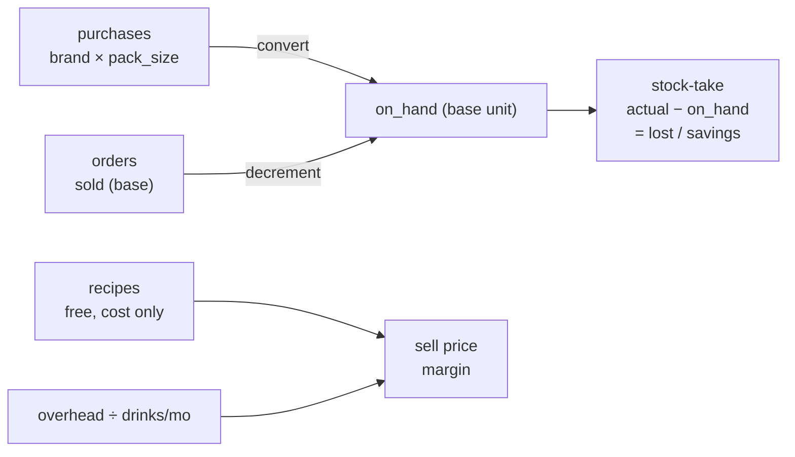

# Sleepless Café — Costing & Inventory Site

**Final Plan** · Caloocan, PH · ₱ PHP · staff-only

Stack: **GitHub Pages** (static frontend) + **Supabase free tier** (data store).
Privacy: GitHub Pages URL stays **unlisted** (never linked from the FB page) + a **passphrase gate**. Real auth = Supabase.

---

## 1. What the site does

A staff-facing tool that turns raw purchases into a checked, auditable costing record for the café. Flow: **cost up → price down → sell → reconcile**.

| # | Page | Role |
|---|---|---|
| 0 | Gate | passphrase → session token |
| 1 | Purchases | buy stock, set ₱/base-unit, low-stock flag, restock |
| 2 | Recipes | drink = ingredients, S/M/L, cost auto-computed — **free, no draw-down** |
| 3 | Overhead | rent / depreciation / salary / utilities → per-cup via drinks/month |
| 4 | Selling price | sell price per drink/size, margin — **staff-only reference** |
| 5 | Ordering list | daily tickets, **decrement stock on sell**, block on negative |
| 6 | Stock-take | count in **base units**, variance → lost cost / savings / net, history |

All pages sit behind the gate. No public menu; prices are a staff reference during client interaction.

---

## 2. Data model (Supabase — 5 tables)

### `purchases`
| field | note |
|---|---|
| name | ingredient name |
| brand | different brands have different pack sizes |
| pack_size | e.g. 250 ml/can, 350 ml/can |
| base_unit | ml, g, piece, kg — the common denominator |
| qty_packs | how many packs/cans bought |
| cost_price | what you paid (₱) |
| supplier | |
| date | date bought |
| low_at | low-stock threshold in base units |

### `recipes`
| field | note |
|---|---|
| drink_name | |
| size | S / M / L |
| ingredients | `[{purchase_id, qty_base}]` — qty in base unit, unit inherited from the purchase row |

### `overhead`
| field | note |
|---|---|
| label | rent, depreciation, salary, utilities… |
| amount | ₱ |
| period | monthly / annual |

### `orders`
| field | note |
|---|---|
| date, time | |
| lines | `[{recipe_id, size, qty}]` |
| running_total | ₱ |

### `stocktakes`
| field | note |
|---|---|
| date, counter | who counted |
| lines | `[{purchase_id, actual_base, variance, impact}]` |
| totals | lost cost, savings, net |

### Derived (never stored)
```
price_per_base = cost_price / (qty_packs × pack_size)
on_hand_base   = Σ(qty_packs × pack_size) − Σ(sold_base)
variance       = actual_base − on_hand_base
impact         = |variance| × price_per_base   (− = lost, + = savings)
recipe_cost    = Σ(ingredient qty_base × price_per_base)
overhead_per_cup = Σ(monthly overhead) / drinks_per_month
margin         = sell_price − (recipe_cost + overhead_per_cup)
```

---

## 3. Why base unit

You buy the **same ingredient from different brands at different pack sizes** (250 ml can vs 350 ml can). The base unit is the common denominator, so everything reconciles regardless of brand.

```
on_hand (base) = cans × pack_size
```

Example — milk:
- 4 cans × 250 ml = **1,000 ml** on hand, ₱45 → **₱0.045/ml**
- 3 cans × 350 ml = **1,050 ml** on hand, ₱40 → **₱0.038/ml**
- Stock-take counts **ml**, not cans. A recipe uses **ml**. Everything reconciles on the base unit.

---

## 4. The cost-up → price-down chain



---

## 5. Page-by-page behavior

**1. Purchases** — add row: name, brand, pack size, base unit, qty packs, price paid, supplier, date. Site shows `₱/base` and a **Low** badge when `on_hand < low_at`. A **Restock** action adds qty without changing the recorded price.

**2. Recipes** — pick a drink, set S/M/L ingredient amounts (each amount references a purchase row, so its unit is inherited). Cost per size = Σ (amount × current ₱/base). Card shows `Name · Size · Ingredients · Cost ₱`. **Creating a recipe is free — it never reduces stock.** It only computes the cost of one cup.

**3. Overhead** — list of monthly/annual totals (rent, depreciation, staff salary, utilities). Plus one input: **expected drinks/month**. Site computes `overhead_per_cup = Σ monthly ÷ drinks_per_month`. This feeds page 4.

**4. Selling price** — set sell price per drink per size. `margin = sell − (recipe_cost + overhead_per_cup)`. Staff-only view shows cost + margin; prices are a reference you consult when talking to clients.

**5. Ordering list** — daily tickets. Each line = drink + size + qty. On submit, **decrement stock** for every ingredient. If an ingredient would go negative → **block the order and flag "out of stock"**. Running total per ticket.

**6. Stock-take** — physical count reconciles record vs actual. Enter `actual_base` per item. Site computes variance and cost impact:

| variance | meaning | impact |
|---|---|---|
| negative | record > reality — waste, spoilage, theft, unlogged use | **lost cost** = |variance| × ₱/base |
| positive | reality > record — stock exists, never purchased | **unrecorded gain / savings** = variance × ₱/base |

The stock-take also **sets `on_hand = actual_count`**, so the record self-corrects. Footer summary: **Total lost ₱ · Total savings ₱ · Net ₱**. History list of past stock-takes to see drift over time.

---

## 6. Confirmed decisions

- Costing = BOTH recipe costing and order quoting.
- Access = staff only, private, unlisted URL + passphrase gate.
- Stack = GitHub Pages + Supabase free tier.
- Currency = ₱ PHP. Two prices per item: cost price + selling price (margin visible).
- Theme = dark espresso/charcoal, cream text, amber accent for peso figures.
- Units = free text at purchase level; recipes inherit the unit from the purchase row (never re-typed).
- Draw-down = ONLY on sell (page 5). Recipes are free, no draw-down.
- Overhead → per-cup conversion = yes, via expected drinks/month.
- Sizes = S / M / L, ingredient amounts per size.
- Menu/prices = hidden, staff-only. No public menu page.
- Stock-take unit = BASE unit (ml/g/piece). Reason: different brands have different pack sizes per can.
- Expected drinks/month = global default + optional per-drink override for top sellers.

---

## 7. Build order

1. GitHub Pages static frontend skeleton (dark espresso theme, 6 pages, passphrase gate).
2. Supabase project + the 5 tables, free tier.
3. Wire in this order: page 1 (purchases + ₱/base) → page 6 (stock-take reconcile) → page 2 (recipe cost) → page 3 (overhead/cup) → page 4 (margin) → page 5 (orders + draw-down).
