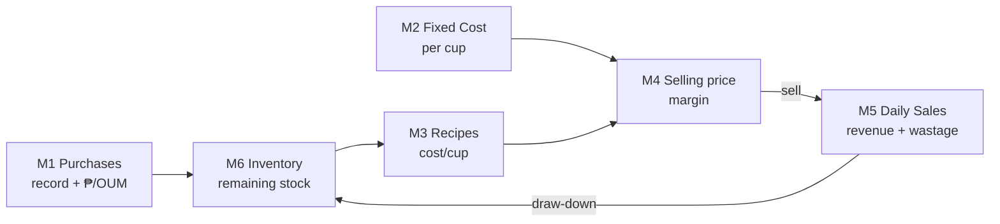

# Sleepless Café — Revision Plan (Modules R0 → R12)

Companion to `PLAN.md` (spec) and `DEV_PLAN.md` (original P0–P10 build).
This plan **supersedes the 6-page map** with the 6-module map from `MODULE1-webpage1.md`.
Same discipline as before: every phase ends with a checkpoint that must pass before the next starts.

**Baseline at time of writing:** `origin/main` = `7c4bdc6`; `app.js` has an **uncommitted local edit**
(restock card removed, never pushed). `MODULE1-webpage1.md` untracked. Fix this in R0 before anything else.

**Status tracker:** R0 ✅ · R1 ✅ · R2 ✅ · R3 ✅ · R4 ✅ · R5 ✅ · R6 ✅ · R7 ✅ (verified, no code change — already wired by R5+R6) · R8 ✅ · R9 ✅ (5c768f1 — verified: Coffee SC0003 actual 1700 → variance −100, impact −₱50.00 LOST, footer Total lost ₱50.00 / savings ₱0.00 / Net ₱-50.00, §1 stock table remaining 1700 g; M1 §3 stock value card followed ₱985.00→₱935.00 via shared inventoryRows()) · R10 ✅ (2065f1e — verified: nav = Dashboard + exactly 6 module titles in module order (Purchases, Overhead, Recipes, Selling price, Daily Sales, Inventory; overhead before pricing); no ordering/orders refs; dashboard cards = Stock value ₱985.00 / Low-stock 0 / Sales recorded this month 0; get_errors clean) · R11 ✅ (2df962a — verified: UOM dropdown shows ml/mg/g/pc/kg; per-OUM figures use rate() (₱0.045/₱0.038/₱0.50), totals use peso() (₱45.00/₱900.00); print buttons on inventory + daily-sales; mobile 390px screenshot shows stacked nav + horizontal-scroll tables; README/PLAN/DEV_PLAN updated to 6-module map + Ordering-retired note + latest-cost-wins caveat; get_errors clean) · R12 ✅ (pushed c53ba3c..ac2b582; Pages build status=built at ac2b582 — verified: live Pages app.js serves new 6-module code (daily-sales, renderInventory, renderDailySales, UOM ml/mg/g/pc/kg, Ordering retired) via curl; gate on live URL blocks w/o passphrase, rejects wrong pass, unlocks on 'sleepless'; seed data renders ₱985.00. Privacy unchanged: repo public, URL unlisted, noindex/nofollow, only publishable key in code, secret never committed. NOTE: integrated-browser tool serves a stale cached app.js — curl + Pages build status are authoritative.) — ALL PHASES R0–R12 COMPLETE. · M5: R40 ✅ (verified live at :8731 — nav + Daily Sales entry render, no console errors) · R41 🟡 code in place (grid DOM + `.field` selects + disabled-cell styling + backend cell predicate; `form` reverted to `div` and `sizes = ['S','M','L']` added after subagent defects), browser done-when check and code commit still pending — terminal disabled, so no `git`/`curl` this turn.
Live state after R3: `purchases` = 3 seed rows (SC0001/2/3), `settings.next_inventory_seq` = 5,
`target_daily_cups` = 100, `daily_sales` empty. R3 checkpoint note: plan text says "₱0.052" but
₱52 ÷ (2×250 ml = 500 ml) is genuinely **₱0.104/ml** — arithmetic slip in the plan; the logic
(newest rate wins, remaining sums both rows) is verified correct.

---

## Module map (new)

Modules = **separate pages**, sections stacked inside. The nav bar is the back-and-forth mechanism;
no in-page tabs (tabs would break `window.print()` export and per-page Supabase loading).

| # | Module | Page id | Sections |
|---|---|---|---|
| 1 | Purchases | `purchases` | §1 stock value + low stock · §2 entry form · §3 inventory table (+ audit record) |
| 2 | Fixed Cost / Overhead | `overhead` | §1 target daily cup sales · §2 expense entry · §3 cost table (per cup/day/month/year) |
| 3 | Recipes | `recipes` | drink · size · ingredients by Inventory ID · cost auto, no draw-down |
| 4 | Selling price | `pricing` | sell price · all-in · margin |
| 5 | Daily Sales Recording | `daily-sales` | date+recorder · cups sold per recipe/size · wastage/spoilage/spills · summary · history |
| 6 | Inventory | `inventory` | remaining stock · reconcile (lost/savings/net) · history |

Old `ordering` page is **retired** — replaced by Module 5.

**Render order in `buildSite()` must stay:** purchases → overhead → recipes → pricing → daily-sales → inventory.
`OVERHEAD_PER_CUP` is a module-level `let` set by `renderOverhead()` and consumed by `renderPricing()`;
overhead **must** render before pricing or margins silently use a stale figure.

---

## R0 — Clean the baseline

**Goal:** local tree and `origin/main` agree before the revision starts.

- Commit the pending `app.js` edit (restock card removal) as its own commit.
- `git add MODULE1-webpage1.md` (or add `MODULE*.md` to `.gitignore` if these are scratch notes — decide once).
- Confirm `git diff origin/main` is empty.

**Done-when:** `git status --short` clean, local `main` == `origin/main`.

**Unlocks:** every phase. A dirty baseline makes later "revert to seed" steps ambiguous.

---

## R1 — Schema migration (Supabase SQL console)

**Goal:** tables accept the new module shapes. No frontend changes here.

Deliverables
- `purchases`: add `inventory_code text` (unique, format `SC0001`), keep `low_at` (per-row; the **newest** row's value is the item's threshold).
- `settings`: add `target_daily_cups numeric` and `next_inventory_seq numeric`.
- `overhead`: **`period` must accept `yearly | monthly | daily | cup`.**
  ⚠ `schema.sql` has `check (period in ('monthly','annual'))`. If that CHECK is live, POSTing `daily`/`cup` returns **HTTP 400**.
  Verify with a probe POST first; if it fails, drop the check (`ALTER overhead DROP CHECK …` or recreate the table).
- New table `daily_sales`: `date`, `recorder`, `lines jsonb [{recipe_id,size,cups}]`, `wastage jsonb [{inventory_code,qty_oum,reason}]`, `totals jsonb {revenue,cogs,gross,wastage,net,oversold:[]}`.
- Seed: give the 3 existing purchases `SC0001` Milk A, `SC0002` Milk B, `SC0003` Coffee; set `next_inventory_seq = 4`.
- Keep `orders` table in place (unused by new pages) — do not delete until R10 confirms nothing reads it.

**Done-when:** `curl …/rest/v1/purchases?select=inventory_code` returns the 3 seeded codes; a probe POST to `overhead` with `period="cup"` returns 200/201.

**Unlocks:** R2+.

---

## R2 — Inventory ID scheme (`SC0001`)

**Goal:** new purchases get the next code, and **deleted numbers are never reused**.

- `settings.next_inventory_seq` is the single source of truth: read it, format `SC` + `String(n).padStart(4,'0')`, `PATCH` it to `n+1` on a successful add.
- Monotonic counter — **never** scan for the lowest free number. Deleting `SC0004` must leave the counter at 5.
- Guard against a stale/missing counter: if `settings` is empty or the value is null, fall back to `max(existing codes) + 1`.
- Case-insensitive, trimmed compare when matching an entered code to an existing item.

**Done-when:** add a throwaway item → it shows `SC0004`, counter reads 5; delete it → counter **stays 5**, next add is `SC0005`. Then delete the throwaway and confirm purchases back to 3 seeded rows.

**Unlocks:** R3.

---

## R3 — Module 1 §3: inventory aggregation (one row per item)

**Goal:** §3 shows **one row per `inventory_code`**, not one per purchase.

- Group purchase rows by `inventory_code`.
- **₱/OUM = newest purchase of that item** = `cost_price_of_newest / (qty_packs × pack_size)` of that newest row — i.e. `cost_per_pack / OUM_per_pack` of the latest purchase. Latest wins.
- Remaining stock in OUM = Σ over **all** rows of that item of `(qty_packs × pack_size)` − sold − wastage.
- Threshold = newest row's `low_at`.
- Keep the raw purchase rows visible as a collapsed **audit record** under §3 (so latest-cost-wins is auditable).

**Done-when (verbatim):** Milk A 4×250 ml @ ₱45 and a second purchase 2×250 ml @ ₱52 collapse to **one** inventory row: remaining 1,500 ml, ₱/OUM = **₱0.052** (newest), stock value uses that rate. Then delete the test purchase and confirm the 3 seed rows + 3 codes intact.

**Unlocks:** R4, R6.

---

## R4 — Module 1 §1: stock value + low stock

**Goal:** two cards above the form.

- Stock value ₱ = Σ over items of (remaining OUM × current ₱/OUM). Reuse the `renderDashboard()` math — move it here, leave the dashboard as a summary.
- Low-stock list: items where remaining < threshold, showing the shortfall in OUM.
- Peso totals 2 decimals; **₱/OUM uses `rate()`** (3–4 decimals) — never `peso()`, or ₱0.045/ml prints as ₱0.05.

**Done-when:** seed-only state shows **₱985.00** and 0 low items (matches the P9 dashboard checkpoint).

**Unlocks:** R5.

---

## R5 — Module 2: Fixed Cost / Overhead

**Goal:** target daily cups drive a 4-column cost table.

- §1 editable **target daily cup sales** + an explicit "update saved amount" button (PATCH `settings`). Keep `drinks_per_month` as a **derived** value, not the input.
- §2 expense entry: `Expense item` (suggest from existing labels; **block exact duplicates** — compare trimmed + case-insensitive), `Period measure` = Yearly/Monthly/Daily/Cup, `Amount ₱`.
- §3 cost table columns: Expense item · **per cup** · **per day** · **per month** · **per year**.
- Conversion rule, enforced everywhere: `1 year = 365 days = 12 months` → `days/month = 365/12 = 30.4167`; `1 day = target daily cup sales`.
  - yearly → /12 monthly, /365 daily, /(365 × target) per cup
  - monthly → ×12 yearly, ÷30.4167 daily, ÷30.4167 ÷ target per cup
  - daily → ×30.4167 monthly, ×365 yearly, ÷target per cup
  - cup → ×target daily, ×30.4167×target monthly, ×365×target yearly
- `OVERHEAD_PER_CUP` = Σ(per cup) across all rows — replaces the old `Σ(monthly) ÷ drinks_per_month`.

**Done-when:** Rent ₱18,000 monthly + Salary ₱24,000 monthly + Utilities ₱3,000 monthly at target **100 cups/day** → per month ₱45,000.00, per day ₱1,479.51, **per cup ₱14.79** (= 45000 ÷ (100 × 30.4167)). A second "Rent" entry is **rejected** with a suggestion.

**Unlocks:** R7.

---

## R6 — Module 3: Recipes re-pointed to Inventory IDs

**Goal:** ingredients reference `inventory_code`, not the purchase UUID.

This is the **riskiest refactor in the revision.** Recipes currently store `[{purchase_id, qty_base}]` keyed to a UUID. Once inventory merges to one row per item, a restock creates a *second* purchase row — a recipe pointing at the old UUID now reads the wrong row. Re-keying to `inventory_code` makes a recipe follow the item across restocks.

- Migrate existing seed recipe `ingredients` to `{inventory_code, qty_oum}`.
- `recipeCost` = Σ(qty_oum × current ₱/OUM of that item) — always live, never stored.
- Amounts inherit the item's UOM from the inventory row (never re-typed).
- Saving a recipe still **never** touches stock.

**Done-when:** Latte M (18 g Coffee + 150 ml Milk A) → **₱15.75** (18×0.50 + 150×0.045). Then restock Milk A and confirm the Latte cost **changes** (follows the item) while stock stays consistent.

**Unlocks:** R7, R8.

---

## R7 — Module 4: Selling price

**Goal:** margin reads the new per-cup figure.

- Table: Drink · Size · Recipe cost · Overhead/cup · All-in · Sell price · Margin (green ≥0 / red <0).
- Mostly existing `renderPricing()`; the change is consuming `OVERHEAD_PER_CUP` from R5 and resolving recipe cost via `inventory_code` from R6.
- Keep the staff-only framing: costs + margin visible, no public menu.

**Done-when:** Latte M sell ₱120, recipe ₱15.75, overhead/cup ₱14.79 → all-in ₱30.54, **margin ₱89.46** green.

**Unlocks:** R8.

---

## R8 — Module 5: Daily Sales Recording (new page)

**Goal:** end-of-day record of sales + wastage, with honest accounting.

- §1 date + recorder initials.
- §2 sales lines: drink · size · cups sold → **Revenue ₱** = Σ cups × sell price.
- §3 wastage lines: Inventory ID · qty in OUM · reason (spoilage / spill / burnt / other) → **Wastage ₱** = qty × ₱/OUM.
- §4 summary: Revenue · **COGS ₱** (Σ cups × recipe cost) · Gross profit · Wastage ₱ · **Wastage % of COGS** · Net.
- §5 draw-down: stock − (cups × recipe ingredients) − wastage.
- §6 history of past days.

**SETTLED DECISIONS (user, session 4) — do not revisit:**
1. **Wastage is recorded AT COST and decrements stock.** Every wastage line is valued at ₱/OUM (never at sell price) and **must lower inventory** — §5 draw-down subtracts wastage OUM as well as sold OUM. A wastage line is a pure cost event: it consumes stock, generates **no revenue**.
2. **A spilled cup is a wastage line only — never also a sale line.** One spill = one §3 entry in OUM. It must not appear in §2, or Revenue and COGS both inflate while stock is decremented twice. Enforce this in the UI note.
3. **End-of-day recording cannot block an over-sell** (the day already happened). It only **flags** it: mark the item "oversold" and let the stock-take reconcile correct it. Never reject the record.

Accounting, stated once: `Gross = Revenue − COGS`; `Net = Gross − Wastage`; `Wastage % = Wastage ÷ COGS`.

**Done-when:** 1 Latte M sold (sell ₱120, cost ₱15.75) + 100 ml Milk A wasted (₱0.045/ml = ₱4.50) → Revenue ₱120.00, COGS ₱15.75, Gross ₱104.25, Wastage ₱4.50, Wastage % 28.6%, **Net ₱99.75**. Milk A remaining drops by 150 + 100 = **250 ml** (sold 150 + wasted 100 — both decrement).

**Unlocks:** R9.

---

## R9 — Module 6: Inventory page

**Goal:** remaining stock + reconcile + history in one place.

- §1 stock table: Inventory ID · Item · UOM · Remaining OUM · ₱/OUM · stock value ₱ · Low? badge.
- §2 reconcile: enter actual count in OUM → `variance = actual − remaining`, `impact = |variance| × ₱/OUM`, LOST (neg) / SAVINGS (pos); footer Total lost · Total savings · Net. Saving **sets remaining = actual**.
- §3 draw-down log: what sold/wasted today.
- §4 history: past stock-takes + past daily-sales records.

**SETTLED (user, session 4):** one shared `inventoryTable()` function is the single source of truth — never two independent implementations. **M6 §1 is the authoritative full view** (table + reconcile + history). **M1 §3 renders the same shared function's output** as a compact view with a nav link to `#inventory` for reconcile/history. The Purchases page still shows an inventory table (per the user's spec), but it is the *same* code, so the two pages can never drift apart.

**Done-when:** Coffee remaining 1,800 g, actual 1,700 → variance −100, impact **−₱50.00 LOST**, totals lost ₱50.00 net ₱-50.00, and remaining now reads 1,700 g.

**Unlocks:** R10.

---

## R10 — Nav, page order, retire Ordering, dashboard rewire

**Goal:** the shell matches the module map.

- `PAGES` array → 6 new entries in module order (keep `overhead` before `pricing`).
- Delete `renderOrdering()` and its `buildSite` branch; confirm nothing else reads `orders` (`soldByPurchase()` must be re-keyed to read `daily_sales` instead).
- Dashboard cards → stock value ₱ · low-stock count · **sales recorded this month** (was "quotes this month").
- `addDeleteCard` wiring: remove from `orders`, add to `daily_sales`.

**Done-when:** nav shows exactly the 6 module titles + Dashboard; no `btn`/branch references `ordering`; `get_errors` clean on `app.js`.

**Unlocks:** R11.

---

## R11 — Polish + docs

**Goal:** formatting, units, print, mobile, and the docs tell the truth.

- UOM dropdown: add **`pc`** and **`kg`** (keep `mg` — harmless, near-useless in a café).
- `rate()` for every per-OUM figure; `peso()` for totals only.
- Print/export for the stock-take sheet, daily-sales record, and inventory sheet.
- Mobile at 390 px: hamburger nav, `.table-wrap` horizontal scroll on the new wider tables.
- Update `README.md`, `PLAN.md`, `DEV_PLAN.md` to the module map; note the retired Ordering page.
- Record the known caveat: **latest-cost-wins re-prices history** — a stock-take lost-cost shifts if a later purchase of that item had a different cost. If that ever matters, store ₱/OUM at time-of-record instead of deriving it.

**Done-when:** dropdown shows `ml/mg/g/pc/kg`; mobile screenshot shows stacked nav + scrollable tables; docs match the code.

**Unlocks:** R12.

---

## R12 — Deploy + live checkpoint

**Goal:** live Pages matches local.

- Commit + push each phase's work (checkpoint per phase, as before).
- Re-verify on the live URL: gate blocks without passphrase, wrong passphrase rejected, correct passphrase unlocks, all 6 modules render with data.
- Privacy model unchanged: repo public, URL unlisted, `noindex, nofollow`, only the publishable key in code, secret never committed.
- Assistant never handles credentials — the user pushes.

**Done-when:** live URL shows the 6-module layout with the seed data and the gate behaves correctly.

---

## Gotchas (verified against current code — read before coding)

1. **`overhead.period` CHECK clause** in `schema.sql` rejects `daily`/`cup` with HTTP 400. Probe and drop it in R1 — this is the most likely silent failure in the whole revision.
2. **`pricing.size` CHECK was already dropped** during the Supabase SQL step (Monaco auto-closes quotes, mangling `('S','M','L')`). Don't assume schema.sql matches the live table — **verify live before migrating**.
3. **Monaco quote mangling** in the Supabase SQL console: navigate `/sql/new`, wait ~6 s, `textarea.focus()` then `keyboard.type(sql)`. For JSON bodies, use `curl.exe --data-binary @file` — PowerShell inline `-d` mangles JSON.
4. **`soldByPurchase()` is keyed by purchase UUID** (`String(r.id)`). After R3/R6 it must key by `inventory_code`. Every caller (`renderPurchases`, `renderStocktake`, `onHand`) has to change with it — half-done re-keying is the second-most-likely silent corruption.
5. **Supabase writes return empty bodies** (200/201/204). `postData`/`patchData`/`deleteData` already read `res.text()` first — don't reintroduce `res.json()`.
6. **Local browser caches `styles.css`** — hard-reload `:8731` to see CSS changes; live Pages serves fresh.
7. **`OVERHEAD_PER_CUP` render-order dependency** — overhead before pricing in `buildSite()`.
8. **`onHand(r, sold)` assumes one purchase row per item.** With aggregation it needs an item-level variant; don't reuse the row-level version inside the merged table.
9. **`settings` is a one-row table** — PATCH by `id=eq.<settings[0].id>`, POST only if empty.
10. **app.js is one ~1,100-line file.** Each phase adds a `renderX()` + one `buildSite` branch; keep that shape rather than restructuring files mid-revision.

## Effort

R0, R1, R10, R12 are fast. **R2, R3, R6 are the risky ones** (ID counter, aggregation, recipe re-keying) — verify hardest. R5 and R8 are the heaviest new math. R4, R7, R9, R11 are medium.

**Build order rationale:** same as the original — the math foundation first. Inventory identity (R2/R3) must be stable before anything references items by code (R6), before anything sells against them (R8), before anything reconciles them (R9).

---

## Post-plan revision log (R13 → R45) — sessions 6–8

The plan phases R0–R12 are done; user then drove module-by-module fine-tuning rounds (R13–R38b). Full per-round detail lives in the repo memory file; key milestones:

- **R13–R26 — M1 Purchases** (commits 770c3ec … 39ba97a): auto Inventory ID on typed name, live suggestion box (partial hints, exact auto-ID), two-column field rows, per-row Edit (date preserved) + two-click Delete, ID box hard-locked from typing, same-tab reload via `sessionStorage slc_view`, scroll-capped audit table with Date column + captions.
- **R27–R29 — M2 Overhead** (commit 577ae6d): two-column forms, live expense-name suggestions, zero-target guard, cost table without id column + per-row Edit/Delete, clean "≈ 2,738 cups / month" derived line.
- **R30–R37 — M3 Recipes** (commit f1e7720): recipe table + per-row Edit/Delete, two-column form, ingredient dropdown of inventory on hand (blank '—' first option), qty label shows recorded base_unit, per-ingredient cost lines, one-cup cost = live recipe cost + overhead/cup (fresh `overheadPerCup()`, not the stale global), Edit refreshes all live boxes, progressive ingredient disclosure (Ingredient 1 first, next reveals only when previous fully filled, up to 15).
- **R38–R38b — M4 Selling price** (commit a3962d4, pushed f1e7720..a3962d4): `renderPricing()` mirrors M1–M3 UX — fresh overhead per cup, table (Drink/Size/Recipe cost/Overhead per cup/All-in cost/Sell price/Margin/Edit, no id, scroll-y + caption), per-row Edit (PATCH same pricing row), recipe-dropdown form with live margin-preview box, NO Delete column (recipe deletion stays in the Recipes tab), table sorted by margin highest→lowest (unsold rows last) — **sort superseded by R45, see below**.
- **R39–R39c — post-checkpoint polish** (commit 4584a7b, pushed): M2 overhead period/cost table sorted alphabetically; M4 sell-price form suggests a sane sell range (all-in ÷ 0.8 → all-in ÷ 0.6). `origin/main` = **4584a7b**.
- **R40–R44 — M5 Daily Sales grid redesign** (plan written this session; R40–R41 code shipped in `0a51c32`): see the plan section below.
- **R45 — M4 Selling price sort** (this session): `renderPricing()` table order changed from margin-descending to **A–Z by drink name, then S · M · L** — `sizeRank = { S: 0, M: 1, L: 2 }` with `localeCompare(name, undefined, true)` (case-insensitive), mirroring the alphabetical M2 table from R39b. The sell-price `<select>` uses the same comparator so the dropdown mirrors the table top-to-bottom (it previously sorted `Drink (Size)` by plain label, which ordered sizes L, M, S); `option.value` stays `drink||size`, so Edit/POST/PATCH round-tripping is unchanged. Caption now states the order. No fallback rank added — sizes are schema-enforced (`schema.sql`: `check (size in ('S','M','L'))`), so bad data surfaces instead of being hidden. The Margin column is still displayed; it is no longer the sort key.

---

# M5 Daily Sales — grid redesign plan (R40 → R44)

**Why this round exists:** M5 is still the R8 skeleton — a flat form of 6 sale lines where the user must hand-type a **recipe UUID** (`Sale 1: recipe id (copy from Recipes)`) plus 6 wastage lines where they must hand-type an **Inventory ID (SC…)** and qty in OUM. That is the worst UX in the repo: two copy-paste-the-UUID steps, no dropdown, no live feedback, and a spill can be entered as either a sale line or a wastage line, which is exactly the double-count the R8 decisions warn about.

**User decisions (locked — do not revisit):**
1. **Two grids, not one.** A **Sales grid** and a **Spill grid**, each with rows = drink and columns = **S / M / L**.
2. **Dropdown = drink / recipe name only.** Size is never typed and never in the dropdown — it is the **column**.
3. **No spoilage / burnt / "other" lines on M5.** The only wastage entry is the Spill grid.

**The key structural fact (verified, `app.js:1223` / `2001` / `2135`):** `recipes` and `pricing` are already keyed **`drink||size`**. So the grid is a pure **transposition** of the existing drink·size table — the S/M/L columns land on keys that already exist. No new table, no schema change, no new key.

**The wire format must not change (verified, `app.js:99–130` + `1115–1130`):** `soldByPurchase()` and the Inventory §4 history both read `ds.lines` **and** `ds.wastage`. `daily_sales` stays one row per day:
`{ date, recorder, lines:[{recipe_id,size,qty}], wastage:[{inventory_code,qty_oum,reason}], totals:{revenue,cogs,gross,wastage,wastagePct,net} }`.
**R41/R42 change the UI only.** If the wire shape drifts, Inventory silently stops drawing stock down.

---

## R40 — M5 nav entry (mirrors R1 / R19 / R26 / R33)

**Goal:** Daily Sales opens as its own module, after Pricing and before Inventory.

- `buildSite()` already has the `daily-sales` branch (`app.js:320`); confirm render order `purchases → overhead → recipes → pricing → daily-sales → inventory` so `overheadPerCup()` and `rateByCode` are warm.
- `sessionStorage slc_view` restores `#daily-sales` after reload — same mechanism M1–M4 use.

**Done-when:** clicking Daily Sales clears `main` and renders only M5; `:8731/?v=45#daily-sales` reloads back into M5, not Purchases.

**Unlocks:** R41.

**Agent:** **Backend Division** (controller/nav wiring) — 15 min, low risk.

---

## R41 — M5 grid form UX (the big one; mirrors R2 / R14 / R27 / R34)

**Goal:** the mockup. Two grids, drink dropdown, S/M/L columns.

- **Sales grid** — rows added with `+ Add drink`; each row = `[ drink ▾ | S | M | L ]`.
- **Spill grid** — identical shape, separate section below.
- Dropdown options = **distinct drink names** from `recipes` (newest-first, deduped) — NOT `drink (Size)` as M4 does, and never a UUID.
- **A cell is only live if that `drink||SIZE` exists.** No recipe/price for Latte M → grey the cell, reject a value there. This is what kills the "sell a size that was never priced" hole.
- **One dropdown row feeds both grids' maths but the grids stay independent** — a drink may appear in Sales and, separately, in Spill.
- Two-column field rows, `.field` selects, live boxes — match M1–M4 exactly.

**Done-when:** dropdown shows drink names only; typing `Latte` suggests existing Latte rows; entering `3 / 2 / 1` in the Sales row and `0 / 1 / 0` in the Spill row renders both grids with those cells and no validation error.

**Unlocks:** R42.

**Agent:** **frontend-lead** (grid DOM, `.field` selects, disabled-cell styling, two-column rows, accessibility labels) — heaviest item, ~2 h. Hand off the cell-enable predicate to Backend, not the math.

---

## R42 — M5 grid → wire format (mirrors R3 / R15 / R28 / R35)

**Goal:** the grids compile into the **unchanged** `daily_sales` row.

- Each non-zero Sales cell → `lines.push({ recipe_id, size, qty })` — `size` comes from the **column**, `recipe_id` resolved from the drink name + size.
- Each non-zero Spill cell → expand the cup **through its recipe ingredients** into `wastage.push({ inventory_code, qty_oum, reason: 'spill' })`. This is the one non-obvious step: the user never types an Inventory ID or an OUM amount, yet `soldByPurchase()` still needs OUM-by-code to draw stock down.
- Zero / blank cells → no row. Reject negatives and non-numeric cells.
- Keep `totals` exactly as R8 defines: `Gross = Revenue − COGS`, `Net = Gross − Wastage`, `Wastage % = Wastage ÷ COGS`.
- **Never reject the record on oversell** (R8 decision 3) — flag `OVERSOLD`, let the stock-take reconcile.

**Done-when:** the R8 worked example still reproduces through the grid — 1 Latte M sold (sell ₱120, cost ₱15.75) + 1 Latte M spilled → Revenue ₱120.00, COGS ₱15.75, Gross ₱104.25, Wastage = Latte M's ingredient OUM at ₱/OUM, Net below Gross, and Milk A remaining drops by **sold + spilled** OUM (both decrement). Verify the posted JSON body has the same keys as before.

**Unlocks:** R43.

**Agent:** **backend-lead** (grid→row compilation, recipe expansion, totals, POST body) — highest-risk item; the recipe-expansion step is where a wrong OUM silently corrupts Inventory.

---

## R43 — M5 display table + live preview (mirrors R4 / R16 / R29 / R36)

**Goal:** the day reads as a table, and the cost preview is live before submit.

- Scroll-y audit table with caption, one row per **drink·size that has activity**, columns: Drink · Size · Sold · Spilled · Revenue · COGS · Net contribution. No UUID column (M1–M4 dropped ids from tables).
- Live preview box beside the grids: **Revenue ₱ · COGS ₱ · Wastage ₱ · Net ₱** recomputed on every cell edit, so the user sees the number before pressing `Record day`.
- Per-row **Edit** re-opens that drink in the grid; **Delete** zeroes the row. Two-click Delete, same as M1.
- Keep `addPrintButton` and the `addDeleteCard` for deleting a whole recorded **day** (that id is a day id, not a drink id — label it so).

**Done-when:** table sorted by revenue highest→lowest; preview box updates without reload; deleting a row zeroes its contribution in both the box and the table.

**Unlocks:** R44.

**Agent:** **frontend-lead** (table render, scroll-y + caption, live box, Edit/Delete rows) — ~1 h.

---

## R44 — M5 polish + verification (mirrors R11 / R37–R39c)

**Goal:** same bar as M1–M4, then commit + push.

- Sort rows consistently (revenue desc, zero-activity rows last); suggest sane ranges where useful.
- Fresh local `overheadPerCup()` — **do not** read the module-level `OVERHEAD_PER_CUP` global (R34 gotcha; Recipes/Pricing/DailySales each define their own).
- Docs: append this round to the revision log; commit code separately from docs.
- **QA gate:** run the R42 worked example end-to-end at `:8731`, then confirm Inventory draw-down and §4 history still agree with the posted row — that is the regression that matters, not the styling.

**Done-when:** M5 verified at `:8731/?v=46#daily-sales`; `git status` clean; code commit and docs commit pushed; `origin/main` = new code SHA.

**Agent:** **qa-engineer** (terminal build check, live-example reproduction, Inventory regression check, git hygiene) — run last, do not skip.

---

## M5 gotchas (verified against current code — read before coding)

1. **`soldByPurchase()` reads `ds.lines` AND `ds.wastage`.** The Spill grid must emit `{inventory_code, qty_oum}`, not `{drink, size, cups}`. Expanding a spilled cup through its recipe is mandatory or Inventory stops drawing stock down.
2. **`daily_sales` is one row per day with JSON arrays**, not one row per sale. Do not "flatten the grid into one POST per cell" — that breaks every reader at `app.js:103`, `421`, `977`, `1115`.
3. **`pricing.size` CHECK was already dropped live** (gotcha 2 above). A cell may reference a size that has no price row → `sellByKey[key] == null` → revenue silently 0. Grey the cell instead of pricing it at ₱0.
4. **`reason` is free text today** and nothing filters it. Narrowing M5 to spill means writing `reason: 'spill'` — keep the key, since history rendering and future reconciliation may read it.
5. **`recById` is built from `recipes` by `id`; the grid dropdown gives names.** Resolve name+size → recipe row first (`drink||size` key, same as `app.js:2009`), then take its `id` for `lines[].recipe_id`.
6. **No build step, no linter, no tests.** Verification = reproduce the worked example in the browser and diff the posted JSON body.
